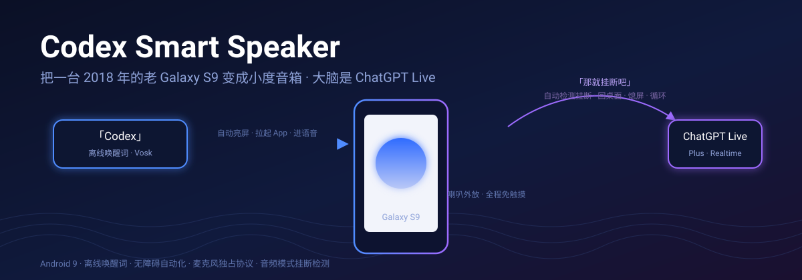
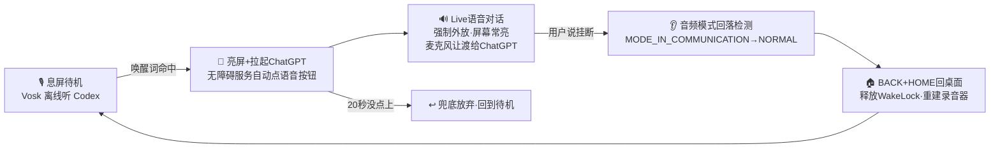
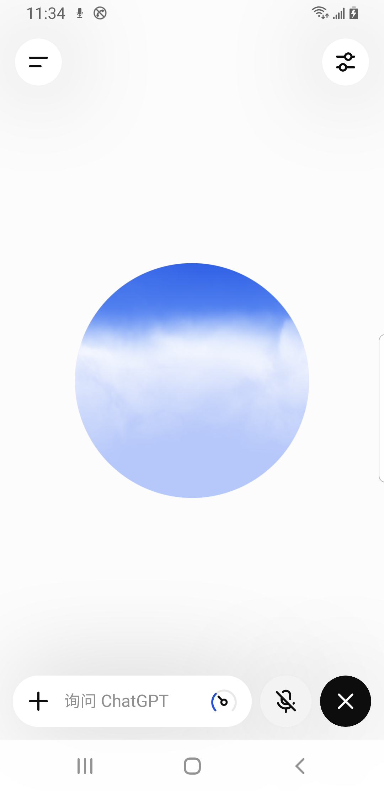
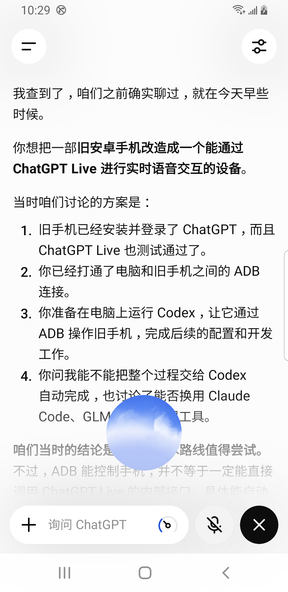
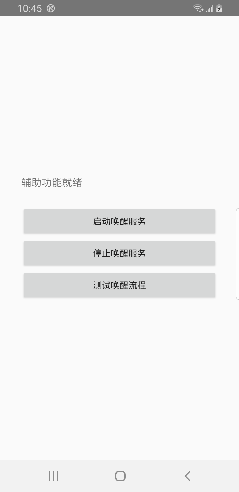

<p align="center">
  
</p>

<h1 align="center">Codex Smart Speaker 📢🤖</h1>

<p align="center">
  <b>把一台 2018 年的吃灰 Galaxy S9，改造成"小度音箱"——但大脑换成 ChatGPT Live。</b><br/>
  插上充电座随意放着：喊一声 <b>「Codex」</b>，它自己亮屏、自己进语音模式、自己用喇叭外放；<br/>
  聊完说「<b>那就挂断吧</b>」，它自己挂断、回桌面、熄屏，等你下一声。周而复始。
</p>

<p align="center">
  <a href="#-演示"><b>🎬 演示</b></a> ·
  <a href="#-工作原理"><b>⚙️ 原理</b></a> ·
  <a href="#-真机截图"><b>📸 截图</b></a> ·
  <a href="#-快速开始"><b>🚀 快速开始</b></a> ·
  <a href="#-文档导航给未来的维护者"><b>📚 深度文档</b></a>
</p>

---

## ✨ 它能干什么

- 🎙️ **息屏待机，喊"Codex"唤醒**——离线识别（Vosk），不联网、不要账号、不花钱
- 📱 **全自动**：亮屏 → 拉起 ChatGPT → 自动点击进入语音模式 → 强制外放 + 音量 80%
- 💬 **正常语音聊天**，全程免触摸，屏幕常亮显示字幕
- 🫱 **说"那就挂断吧"**（ChatGPT 自带语音挂断）→ 管家检测到挂断 → 自动回桌面 → 熄屏 → 恢复监听
- 🔁 **无限循环**，开机自启、崩溃自愈（前台服务 + 电池白名单）
- 🧠 大脑是 ChatGPT Live（Plus），模型质量随云端升级，**App 只是话筒**

## 🎬 演示

**完整闭环实录（80 秒，手机屏幕录制）**：黑屏待机 → 喊 Codex → 自动亮屏进语音 → ChatGPT 外放说话 → 语音挂断 → 自动回桌面熄屏。

https://github.com/piginzoo/codex-smart-speaker/raw/main/docs/img/demo.mp4

<p align="center">
  
</p>

## ⚙️ 工作原理



三条**核心设计**（详细推导见 [技术架构](docs/04-技术架构.md)）：

1. **麦克风独占协议** —— 三星设备上并发录音"先到先得"，管家的监听循环如果一直占着麦，ChatGPT 的 WebRTC 会被**饿死**（live 永远转圈）。会话期间管家把 AudioRecord **对象级销毁**，挂断后重建。
2. **挂断检测 = 音频模式回落** —— ChatGPT 是 Compose 应用，无障碍树里**没有任何文字/id** 可读；但 live 会话开着时系统音频必然处于 `MODE_IN_COMMUNICATION`，挂断即回落 `MODE_NORMAL`。看守线程每秒采样，连续 5 秒回落判定挂断——**不依赖 UI、100% 可靠**。
3. **targetSdk 压在 28** —— Android 10+ 会限制后台麦克风（直接判本项目死刑），Android 9 是最后一代宽松系统。**停在 9 是特性不是欠债。**

## 📸 真机截图

| 唤醒后自动进入语音模式（大蓝球） | 语音对话实时字幕 |
|:---:|:---:|
|  |  |
| **管家 App（状态一目了然）** | **挂断后自动回到聊天界面** |
|  |  |

## 🚀 快速开始

<details open>
<summary><b>硬件与软件要求</b></summary>

- 一台 **Android 9** 的手机（本项目为 Galaxy S9 国行；Android 10+ 会限制后台麦克风，理论可用但未验证）
- 锁屏密码**去除**（喊一声就唤醒的前提）
- 手机网络可达 ChatGPT（本项目走路由器级分流，手机裸连）
- ChatGPT 账号（语音模式用量：Plus 宽裕；免费账号有每日限额）
- Mac/Linux 开发机：adb、openjdk@17、gradle 8.9、android-sdk (platforms;android-28 + build-tools;34.0.0)

</details>

<details>
<summary><b>① 手机侧：ChatGPT 环境（一次性）</b></summary>

1. **装 GMS**（国行机需要）：Play 服务 + Play 商店以用户 App 身份侧载，登录 Google 账号——这既是 PairIP 授权校验的钥匙，也让 Play 商店接管 ChatGPT 的版本管理（会自动挑设备兼容的最高版本）
2. **装 ChatGPT**：侧载任意版本打底 → Play 商店点"通过 Play 更新" → 转为正渠道版（PairIP 放行）
3. ChatGPT 内登录账号，设置里写好**自定义指令**（相当于系统提示词），手动验证一次语音模式可用

</details>

<details>
<summary><b>② 手机侧：管家 App</b></summary>

```bash
# 构建
export JAVA_HOME=/opt/homebrew/opt/openjdk@17/libexec/openjdk.jdk/Contents/Home
export ANDROID_HOME=<你的sdk路径>
cd ButlerApp && gradle assembleDebug

# 推送 Vosk 模型（约40MB，从 alphacephei.com/vosk/models 下载 small-en-us-0.15）
adb shell mkdir -p /sdcard/Android/data/com.piginzoo.butler/files
adb push vosk-model-small-en-us-0.15 /sdcard/Android/data/com.piginzoo.butler/files/

# 安装 + 配置（必跑！授予麦克风/无障碍/电池白名单/熄屏亮度）+ 重启
adb install -r app/build/outputs/apk/debug/app-debug.apk
./setup_butler.sh
adb reboot
```

</details>

<details>
<summary><b>③ 日常使用</b></summary>

插上充电座，息屏待机。

- 喊「**Codex**」→ 等它自己亮屏进语音（约 10 秒）
- 正常聊天（全程外放，屏幕显示字幕）
- 说「**那就挂断吧**」或点右下角黑叉子 → 它自己收拾干净回桌面熄屏
- 想聊再喊一声

万一异常：打开"语音管家"App 看状态文字；深度排查用 `adb logcat -s ButlerWake`。

</details>

## 📚 文档导航（给未来的维护者）

**本项目会持续迭代。文档为 AI 助手/人类维护者而写，动代码前请先读：**

| 文档 | 内容 | 什么时候读 |
|------|------|-----------|
| [01 · 背景与需求](docs/01-背景与需求.md) | 项目缘起、grill-me 需求拷问的 9 项决策、需求演进（为什么砍掉了字幕识别）、用户体验铁律 | 理解"为什么做成这样" |
| [02 · 环境与动机](docs/02-环境与动机.md) | 为什么是老 S9、为什么不升级 Android 10、国行无 GMS 三座大山、当前环境快照 | 理解"环境约束" |
| [03 · **踩坑全记录**](docs/03-踩坑全记录.md) | ⭐ **15 个问题的完整排查史**：现象→排查→根因→修复→教训（PairIP、坐标系统、a11y 绑定玄学、Compose 无标识、**麦克风饿死 WebRTC**……） | **动手改代码之前必读**，每个坑都标注了教训 |
| [04 · 技术架构](docs/04-技术架构.md) | 组件图、完整时序图、五大设计决策（含被淘汰方案）、已知限制、调试入口速查 | 改架构/加功能 |

## ⚠️ 已知限制

- 会话期间管家"聋了"（麦克风让渡给 ChatGPT，架构约束）——所以会话中喊 Codex 无响应，本来也不需要
- "10 分钟无声自动挂断"无法实现（听不见环境音），兜底为 60 分钟硬上限
- UI 自动化依赖"右下角 144×144 按钮"启发式，ChatGPT 大改版可能失效（有先看后点日志机制兜底，见踩坑 #9）
- 合成音唤醒识别率约 2/3，**真人声实测更稳**

## 🛠️ 技术栈

Kotlin · Android AccessibilityService · [Vosk](https://alphacephei.com/vosk/) 离线语音识别 · AudioManager 音频模式侦测 · adb 深度调试 · ChatGPT Live (WebRTC)

## 📄 License

[MIT](LICENSE) © piginzoo
