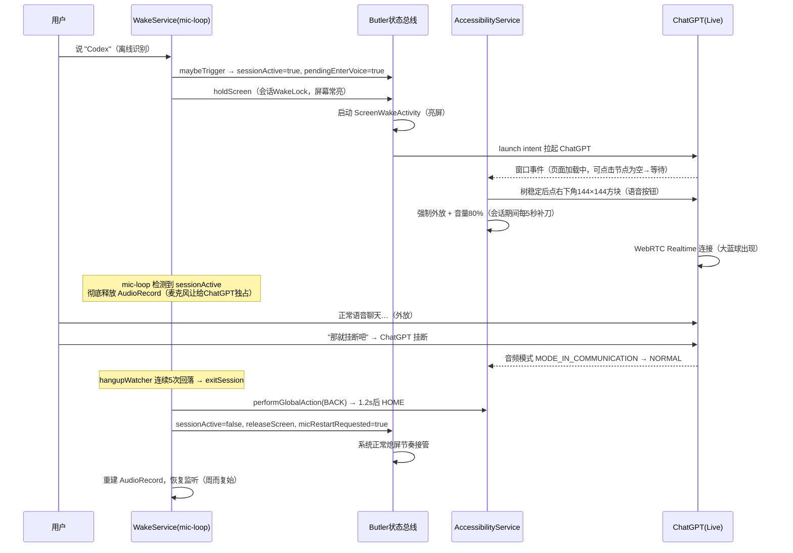

# 04 · 技术架构：怎么实现的，瓶颈在哪，怎么破的

> 面向未来维护者。读完你应该能**不看代码就画出系统运行图**，并且知道每个设计决策背后的"为什么"。被淘汰的方案也写在这里——防止后人重新发明已经失败过的轮子。

## 一、系统全景

```
┌─────────────────────────── 无线充电座上的 Galaxy S9 (Android 9) ───────────────────────────┐
│                                                                                           │
│  ┌─────────────────────────┐        ┌──────────────────────────────────────────────────┐  │
│  │  管家 App (ButlerApp)    │        │  ChatGPT 1.2026.314 (Play 渠道)               │  │
│  │                          │        │                                            │  │
│  │  WakeService (前台服务)   │        │  MainActivity (Compose UI)                 │  │
│  │  ├─ mic-loop: Vosk 监听  │        │  └─ 语音模式 = WebRTC Realtime 会话          │  │
│  │  │  "codex" 及其变体      │───①──→ │     音频模式 MODE_IN_COMMUNICATION           │  │
│  │  ├─ hangupWatcher 线程   │←──②─── │     （挂断时回落 MODE_NORMAL，被看守线程捕获） │  │
│  │  │  每秒查音频模式回落     │        │                                            │  │
│  │  └─ exitSession          │───③──→ │  被 a11y 自动化的动作:                       │  │
│  │                          │        │  点右下角144×144语音按钮 / BACK / HOME       │  │
│  │  ButlerAccessibilitySvc  │        └──────────────────────────────────────────────┘  │
│  │  (无障碍服务：读屏+执行点击+全局BACK/HOME)                                              │
│  │                          │                                                            │
│  │  ScreenWakeActivity      │        ┌──────────────┐                                   │
│  │  (FLAG_TURN_SCREEN_ON)   │        │ Vosk 模型     │ /sdcard/Android/data/.../files/   │
│  │                          │        │ small-en 0.15 │ (70MB，外置不打包)                │
│  └─────────────────────────┘        └──────────────┘                                   │
│             │ WiFi 裸连（路由器级分流，手机零代理软件）                                     │
└─────────────┼─────────────────────────────────────────────────────────────────────────┘
              ▼
     路由器分流 → ChatGPT 服务端（模型质量全在云端，客户端只是"话筒"）
```

① = 听到唤醒词后拉起 ChatGPT + 通知无障碍服务进入"点击语音模式"阶段
② = 用户挂断 → 音频模式回落 → 看守线程捕获（唯一可靠的会话结束信号）
③ = BACK 退出 live + HOME 回桌面（全局动作，不依赖界面事件）

组件源码：`ButlerApp/app/src/main/java/com/piginzoo/butler/` 下 6 个 Kotlin 文件：

| 文件 | 职责 |
|------|------|
| `Butler.kt` | 全局状态总线：sessionActive / pendingEnterVoice / micRestartRequested / WakeLock / triggerSession 主流程 |
| `WakeService.kt` | 前台服务：Vosk 麦克风循环（听唤醒词）+ 挂断看守线程 + exitSession |
| `ButlerAccessibilityService.kt` | 无障碍服务：进入语音模式的 UI 自动化 + 强制外放 + 超时兜底 |
| `ScreenWakeActivity.kt` | 透明 Activity：`FLAG_TURN_SCREEN_ON` 点亮屏幕（锁屏已禁用，无需解锁逻辑） |
| `MainActivity.kt` | 状态展示 + 手动启停 + "测试唤醒流程"按钮（打开 App 即自动启动服务） |
| `BootReceiver.kt` | 开机自启 WakeService |

## 二、核心时序：一次完整唤醒



## 三、五大设计决策（含被淘汰的方案）

### 决策 1：targetSdk = minSdk = 28（编译期压在 Android 9 上）
- **为什么**：targetSdk 决定系统对该 App 施加哪个版本的权限模型。压在 28 = 享受 Android 9 的宽松后台行为（常驻麦克风监听无限制），且永远不会"因为 targetSdk 高而触发新权限语义"。
- **淘汰方案**：targetSdk 34+（合规但触发后台麦克风限制，需求直接报废）。

### 决策 2：麦克风独占协议（本项目最重要的架构约束）
- **为什么**：三星 Android 9 的音频 HAL 对并发录音"先到先得"，后到的实时音频管线（ChatGPT 的 WebRTC）会被饿死（详见踩坑 #11）。管家**在会话期间必须把 AudioRecord 对象级销毁**，不是暂停。
- **实现**：mic-loop 外层 `if (sessionActive) sleep; continue`，永远不打开录音器；会话结束后 `micRestartRequested` 触发重建全新 AudioRecord（防路由残留）。
- **代价**：会话期间管家"聋了"——听不到第二次 Codex、也听不到环境音。可接受：会话中不需要唤醒，挂断信号走看守线程。

### 决策 3：会话结束 = 音频模式回落（UI 无关）
- **为什么**：ChatGPT 是 Compose 应用，无障碍树**没有任何文字/id**（踩坑 #9），UI 判据全灭。而 `AudioManager.mode` 是系统级状态：live 会话开着 = `MODE_IN_COMMUNICATION`，挂断 = `MODE_NORMAL`。看守线程每秒采样，**连续 5 次回落才触发**（防抖动）。
- **淘汰方案**：读字幕找告别语（被需求变更淘汰：live 自带语音挂断）；UI 文字按钮匹配（Compose 无文字，误判频发）；麦克风归还信号（ mic 独占后失效）。

### 决策 4：唤醒词变体白名单 + 离线小模型
- **为什么**：Vosk small-en（40MB/内存约 60MB）对 "codex" 的实际输出不稳定（"kodak's" / "go that"），精确匹配漏报严重。
- **实现**：识别文本按非字母切词，命中 `codex|kodak|kodaks|codecs|codaks|codexs` 任一即触发；外加 10 秒防抖、`sessionActive` 守卫。
- **替代方案**：Porcupine（Picovoice）——免费档 access key 90 天过期，对"装完就忘"的设备不可接受；sherpa-onnx KWS——更精准但 English 关键词 phoneme 配置繁琐。Vosk 是"够用+最简"的平衡点。

### 决策 5：模型外置 /sdcard，不打包进 APK
- **为什么**：70MB 模型进 APK 每次调参都要重装；放 `getExternalFilesDir()` 免权限、adb 直接 push、换模型不动代码。

## 四、已知限制与边界（诚实清单）

1. **会话期间听不见唤醒词**：麦克风已让渡给 ChatGPT（架构约束，不可两全）。影响：会话中喊"Codex"无响应——本来也不需要。
2. **"10 分钟无声自动挂断"在会话中不可实现**：耳朵已经让出去，无法测环境安静度。兜底改为 60 分钟硬上限 + live 自身的长时间静默挂断。如果未来需要此功能，可行方向是**用 AudioRecord 的短期"探头"**（每 60 秒开 1 秒采样）——但要先验证不干扰 WebRTC（踩坑 #11 的风险仍在）。
3. **UI 自动化依赖右下角 144×144 启发式**：ChatGPT 大版本改版（按钮尺寸/位置变化）会导致点击失效。防线：`ButlerWake` 标签的可点击节点 dump 日志 + "先看后点"机制，失效时一轮日志即可重定策略。
4. **合成音唤醒识别率约 2/3**：真人声实测更稳；如需更强壮，可换 sherpa-onnx KWS（英/中关键词模型）。
5. **中文 UI 资源依赖 ChatGPT 包**：Play 装的 1.2026.314 带中文资源；若 Play 推送了不带中文的版本，界面回退英文（语音对话语言不受影响）。

## 五、构建与部署

```bash
# Mac 端依赖：openjdk@17（formula版免sudo）+ gradle 8.9 + android-sdk(platforms;android-28, build-tools;34.0.0)
export JAVA_HOME=/opt/homebrew/opt/openjdk@17/libexec/openjdk.jdk/Contents/Home
export ANDROID_HOME=/Users/piginzoo/android-sdk
cd ButlerApp && gradle assembleDebug          # 产物 app/build/outputs/apk/debug/app-debug.apk

# 推 Vosk 模型（首次）
adb shell mkdir -p /sdcard/Android/data/com.piginzoo.butler/files
adb push vosk-model-small-en-us-0.15 /sdcard/Android/data/com.piginzoo.butler/files/

# 装 App + 配置（必跑）+ 重启（三星 a11y 绑定玄学，见踩坑#8）
adb install -r app/build/outputs/apk/debug/app-debug.apk
./setup_butler.sh
adb reboot
```

## 六、调试入口速查

| 想看什么 | 命令 |
|---------|------|
| 管家全部日志（识别/触发/点击/挂断/看守） | `adb logcat -s ButlerWake` |
| 会话结束信号是否正常 | 上述日志里找 `watcher: mode=...` 和 `exitSession:` |
| a11y 服务是否绑定 | `adb dumpsys accessibility \| grep -A4 "bound services"` |
| 当前音频模式（3=通话中，0=正常） | `adb shell dumpsys audio \| grep "mode:"` |
| 屏幕常亮锁是否持有 | `adb shell dumpsys power \| grep butler:session` |
| WakeService 是否活着 | `adb shell dumpsys activity services com.piginzoo.butler` |
| 手机屏幕方向/分辨率 | `adb shell wm size` + 截图像素尺寸 |
